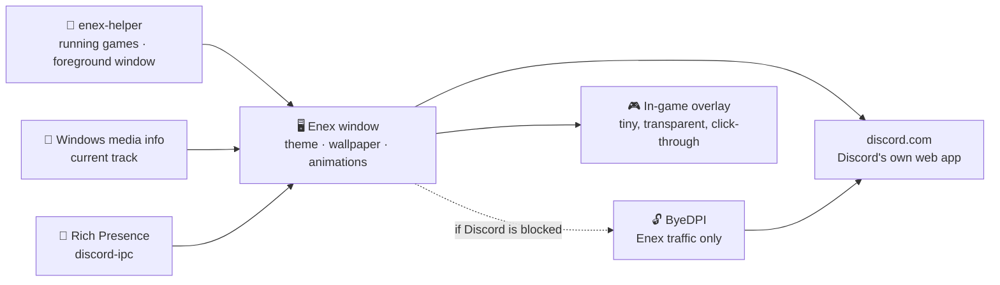

  

  

  
  
  
  

  <a href="README.md">Türkçe</a> · <b>English</b>

---

**Enex** opens Discord in its own window and gives it a whole new look: live wallpapers,
see-through glass windows, neon themes and smooth animations. If Discord is blocked where you
are, it connects **with one click, no VPN needed**.

And now for gamers: an **in-game overlay**, **"Playing / Listening to" status** and a **game mode**
that keeps your FPS where it belongs.

  
   <i>Anime theme: transparent Discord over a live "Sakura Night" wallpaper</i>

## 🆕 What's new (v1.1)

> **Enex 1.1 is the gamer update.** We brought over what desktop Discord has and the web version
> doesn't, then added privacy and performance on top. Full details in [CHANGELOG.md](CHANGELOG.md).

- 🎮 **In-game overlay:** your voice channel (speakers glow) and incoming messages on the game's screen.
- 🕹️ **"Playing" status:** the game you open shows on your profile. ~10,500 games recognized automatically.
- 🎵 **"Listening to" status:** music from Spotify, Apple Music, YouTube Music or your browser.
- 🛡️ **Privacy filter:** only music is shared. Videos you watch and adult content are never shared.
- ⚡ **Game mode:** while you play, Enex's effects stop and its priority drops, leaving your CPU and GPU to the game.
- 🔌 **Rich Presence:** games and apps that report their own status can connect to Enex.
- 🪟 **Pop-out streams:** "Pop out" now opens inside Enex instead of your browser.
- 🔊 **Volume up to 300%** *(v1.1.1)*: user and stream volume go up to 300%. Yellow from 100–200%, red from 200–300%, with warnings at high levels.

## ✨ Why Enex?

<table>
  <tr>
    <td width="50%" valign="top">
      <h3>🎨 8 themes, one click</h3>
      Open the Theme Studio (<kbd>Ctrl</kbd>+<kbd>Shift</kbd>+<kbd>T</kbd>), click a theme, done.
      No restart, no config files.
    </td>
    <td width="50%" valign="top">
      <h3>🌸 Live wallpapers</h3>
      A moving scene behind Discord. Use the built-in one or pick <b>your own video or image</b>.
    </td>
  </tr>
  <tr>
    <td valign="top">
      <h3>🪟 Glass window</h3>
      The window turns see-through so your desktop shows behind it. <b>Frosted</b> or
      <b>fully clear</b>, with adjustable opacity.
    </td>
    <td valign="top">
      <h3>🔓 Built-in unblocker</h3>
      If Discord is blocked, Enex finds a way through on its own. <b>Only Enex's traffic</b>
      is affected; the rest of your PC is untouched.
    </td>
  </tr>
  <tr>
    <td valign="top">
      <h3>🔒 Your account stays safe</h3>
      You log in on Discord's own page. Enex <b>never sees, stores or sends your token.</b>
      The code is open, so you can check for yourself.
    </td>
    <td valign="top">
      <h3>⚡ Light and tweakable</h3>
      Toggle effects, card layout and clean mode, change the accent color. If your PC
      struggles, turn effects off with one shortcut.
    </td>
  </tr>
</table>

Voice, video, screen sharing and notifications work exactly as they do in Discord.

## 🎮 For gamers

<table>
  <tr>
    <td width="50%" valign="top">
      <h3>🎮 In-game overlay</h3>
      See who's in your voice channel while you play, <b>speakers glow</b>. New messages pop up as
      small notifications. Clicks pass through to the game; it never steals focus.
        Toggle it from inside a game with <kbd>Ctrl</kbd>+<kbd>Alt</kbd>+<kbd>O</kbd>.
    </td>
    <td width="50%" valign="top">
      <h3>🕹️ Playing / 🎵 Listening to</h3>
      The game you open and the music you play show on your profile like desktop Discord.
      Games with Rich Presence (map, character, track…) can connect to Enex too.
    </td>
  </tr>
  <tr>
    <td valign="top">
      <h3>🛡️ You decide what's shared</h3>
      The default <b>Smart</b> mode shares music only: music apps and music videos playing in your
      browser. Vlogs, movies and random videos are not shared.
      <b>Adult content is always blocked.</b> Add your own blocked words if you like.
    </td>
    <td valign="top">
      <h3>⚡ Game mode (FPS)</h3>
      While a game is in front, Enex's animations, blur and wallpaper stop and it runs at lower CPU
      priority. The overlay is made of tiny windows only as big as their content.
      Voice chat is never affected.
    </td>
  </tr>
</table>

**Sharing modes** (Theme Studio → Activity sharing):

| Mode | What gets shared |
|---|---|
| Music apps only | Spotify, Apple Music, Deezer, TIDAL… Nothing from the browser. |
| **Smart** (default) | Music apps + **music** playing in the browser (music videos, YouTube Music, Spotify Web…) |
| Any media | Everything you play in the browser. Blocked words are still filtered. |

> [!TIP]
> - For the overlay to show, run your game in **Borderless** or **Windowed fullscreen**. In exclusive
>   "Fullscreen" Windows draws nothing on top of the game.
> - To appear on your profile, keep *User Settings → Activity Privacy → "Share your detected
>   activities with others"* on in Discord. Theme Studio warns you if it's off.

## 🎨 Themes

<table>
  <tr>
    <td align="center"> <b>Aurora</b></td>
    <td align="center"> <b>Anime</b></td>
  </tr>
  <tr>
    <td align="center"> <b>Glass</b></td>
    <td align="center"> <b>Neon Tokyo</b></td>
  </tr>
  <tr>
    <td align="center"> <b>Synthwave</b></td>
    <td align="center"> <b>Abyss</b></td>
  </tr>
  <tr>
    <td align="center"> <b>Obsidian</b></td>
    <td align="center"> <b>Matrix</b></td>
  </tr>
</table>

## 📦 Install

### Easy way (recommended)

1. Download `Enex-Setup.exe` from **[Releases](../../releases/latest)**.
2. Double-click it. Enex installs and adds a desktop shortcut. That's it.

> [!NOTE]
> The app isn't code-signed, so Windows may show a SmartScreen warning.
> Click **More info → Run anyway** to continue.

### Build from source

1. Install [Node.js](https://nodejs.org) (LTS).
2. Click **Code → Download ZIP** on this page and extract it.
3. Double-click **`Setup.bat`**. It handles the rest.

For developers: `npm install`, then `npm start`.

## 🔧 How it works

Enex loads Discord's official web app and adds a **CSS theme** on top. If Discord is
blocked, it starts a tiny local proxy ([ByeDPI](https://github.com/hufrea/byedpi)) in the
background and uses encrypted DNS. It tries several methods in order and remembers the one
that works.

**Game and music detection:**
- A small helper (`enex-helper.exe`) compares running programs with Discord's list of
  recognized games, the same way desktop Discord and arRPC do.
- The current track comes from Windows' media info.
- Whatever is found is handed to Discord as a "local activity", just like the desktop app.
- Nothing is injected into any game. The overlay is a separate window, so it doesn't clash with
  anti-cheats (Vanguard, EAC, BattlEye).

If something doesn't work, the **diagnostic log** in Theme Studio (`enex-debug.log`) shows where it stops.

## ⌨️ Shortcuts

| Shortcut | Action |
|---|---|
| <kbd>Ctrl</kbd>+<kbd>Shift</kbd>+<kbd>T</kbd> | Theme Studio |
| <kbd>Ctrl</kbd>+<kbd>Alt</kbd>+<kbd>1</kbd>…<kbd>8</kbd> | Switch theme |
| <kbd>Ctrl</kbd>+<kbd>Shift</kbd>+<kbd>E</kbd> | Toggle effects |
| <kbd>Ctrl</kbd>+<kbd>Shift</kbd>+<kbd>L</kbd> | Toggle card layout |
| <kbd>Ctrl</kbd>+<kbd>Alt</kbd>+<kbd>O</kbd> | Toggle in-game overlay (works while gaming) |
| <kbd>Ctrl</kbd>+<kbd>R</kbd> | Reload |
| <kbd>Alt</kbd> | Show menu |

## 🖌️ Make your own theme

Copy a file in `themes/`, change its `--nx-...` colors and add it to the `THEMES` list in
`main.js`. Made something nice? Open a Pull Request!

## ⚠️ Disclaimer

Enex is not affiliated with or endorsed by Discord Inc. Modifying the Discord client is against
Discord's Terms of Service. For activity sharing and the overlay, Enex talks to the internals of
Discord's web app (like Vencord and Vesktop do). Bans for client mods are rare, but the risk is not
zero. Use at your own risk.

## 📄 License

[MIT](LICENSE) © 2026 Enes · `bin/ciadpi.exe` is built from [ByeDPI](https://github.com/hufrea/byedpi)
(MIT, see `bin/BYEDPI-LICENSE.txt`). `bin/enex-helper.exe` and `bin/enex-audio.exe` are built from
the `native/` sources in this repo (see `bin/KAYNAK.txt`). The Rich Presence protocol was written
with [arRPC](https://github.com/OpenAsar/arrpc) (MIT) as a reference.

Like Enex? Leave a ⭐!

