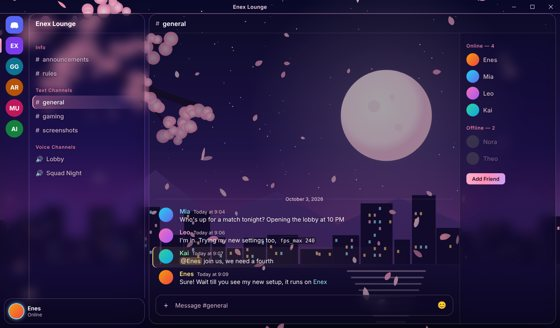
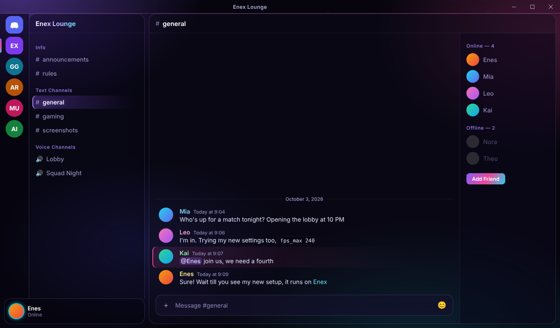
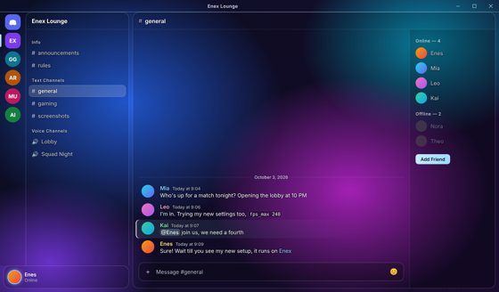
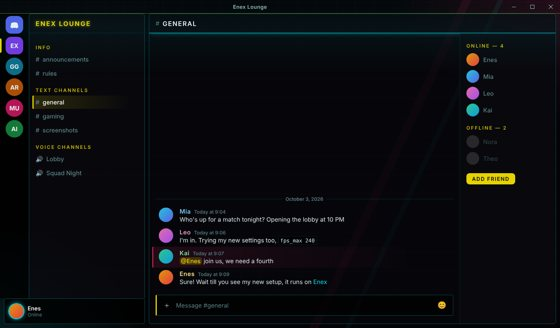
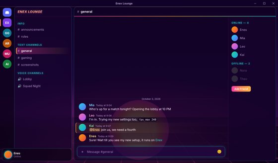
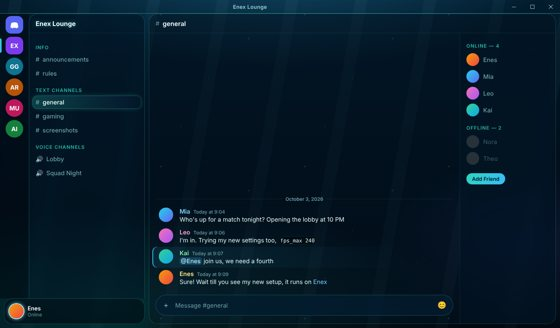
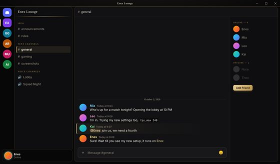
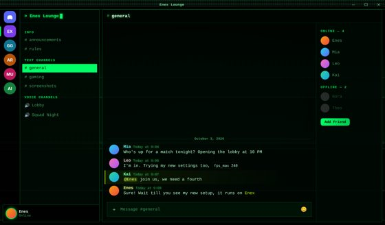
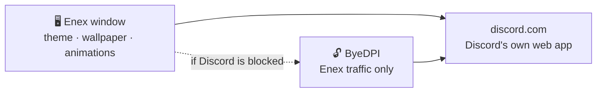

  

  

  
  
  
  

  <a href="README.md">Türkçe</a> · <b>English</b>

---

**Enex** opens Discord in its own window and gives it a whole new look: live wallpapers,
see-through glass windows, neon themes and smooth animations. If Discord is blocked where you
are, it connects **with one click, no VPN needed**.

  
   <i>Anime theme: transparent Discord over a live "Sakura Night" wallpaper</i>

## ✨ Why Enex?

<table>
  <tr>
    <td width="50%" valign="top">
      <h3>🎨 8 themes, one click</h3>
      Open the Theme Studio (<kbd>Ctrl</kbd>+<kbd>Shift</kbd>+<kbd>T</kbd>), click a theme, done.
      No restart, no config files.
    </td>
    <td width="50%" valign="top">
      <h3>🌸 Live wallpapers</h3>
      A moving scene behind Discord. Use the built-in one or pick <b>your own video or image</b>.
    </td>
  </tr>
  <tr>
    <td valign="top">
      <h3>🪟 Glass window</h3>
      The window turns see-through so your desktop shows behind it. <b>Frosted</b> or
      <b>fully clear</b>, with adjustable opacity.
    </td>
    <td valign="top">
      <h3>🔓 Built-in unblocker</h3>
      If Discord is blocked, Enex finds a way through on its own. <b>Only Enex's traffic</b>
      is affected; the rest of your PC is untouched.
    </td>
  </tr>
  <tr>
    <td valign="top">
      <h3>🔒 Your account stays safe</h3>
      You log in on Discord's own page. Enex <b>never sees, stores or sends your token.</b>
      The code is open, so you can check for yourself.
    </td>
    <td valign="top">
      <h3>⚡ Light and tweakable</h3>
      Toggle effects, card layout and clean mode, change the accent color. If your PC
      struggles, turn effects off with one shortcut.
    </td>
  </tr>
</table>

Voice, video, screen sharing and notifications work exactly as they do in Discord.

## 🎨 Themes

<table>
  <tr>
    <td align="center"> <b>Aurora</b></td>
    <td align="center"> <b>Anime</b></td>
  </tr>
  <tr>
    <td align="center"> <b>Glass</b></td>
    <td align="center"> <b>Neon Tokyo</b></td>
  </tr>
  <tr>
    <td align="center"> <b>Synthwave</b></td>
    <td align="center"> <b>Abyss</b></td>
  </tr>
  <tr>
    <td align="center"> <b>Obsidian</b></td>
    <td align="center"> <b>Matrix</b></td>
  </tr>
</table>

## 📦 Install

### Easy way (recommended)

1. Download `Enex-Setup.exe` from **[Releases](../../releases/latest)**.
2. Double-click it. Enex installs and adds a desktop shortcut. That's it.

> [!NOTE]
> The app isn't code-signed, so Windows may show a SmartScreen warning.
> Click **More info → Run anyway** to continue.

### Build from source

1. Install [Node.js](https://nodejs.org) (LTS).
2. Click **Code → Download ZIP** on this page and extract it.
3. Double-click **`Setup.bat`**. It handles the rest.

For developers: `npm install`, then `npm start`.

## 🔧 How it works

Enex loads Discord's official web app and only adds a **CSS theme** on top. If Discord is
blocked, it starts a tiny local proxy ([ByeDPI](https://github.com/hufrea/byedpi)) in the
background and uses encrypted DNS. It tries several methods in order and remembers the one
that works.

## ⌨️ Shortcuts

| Shortcut | Action |
|---|---|
| <kbd>Ctrl</kbd>+<kbd>Shift</kbd>+<kbd>T</kbd> | Theme Studio |
| <kbd>Ctrl</kbd>+<kbd>Alt</kbd>+<kbd>1</kbd>…<kbd>8</kbd> | Switch theme |
| <kbd>Ctrl</kbd>+<kbd>Shift</kbd>+<kbd>E</kbd> | Toggle effects |
| <kbd>Ctrl</kbd>+<kbd>Shift</kbd>+<kbd>L</kbd> | Toggle card layout |
| <kbd>Ctrl</kbd>+<kbd>R</kbd> | Reload |
| <kbd>Alt</kbd> | Show menu |

## 🖌️ Make your own theme

Copy a file in `themes/`, change its `--nx-...` colors and add it to the `THEMES` list in
`main.js`. Made something nice? Open a Pull Request!

## ⚠️ Disclaimer

Enex is not affiliated with or endorsed by Discord Inc. Modifying the Discord client is against
Discord's Terms of Service. Bans for purely cosmetic changes are rare, but the risk is not zero.
Use at your own risk.

## 📄 License

[MIT](LICENSE) © 2026 Enes · `bin/ciadpi.exe` is built from [ByeDPI](https://github.com/hufrea/byedpi)
(MIT, see `bin/BYEDPI-LICENSE.txt`).

Like Enex? Leave a ⭐!

