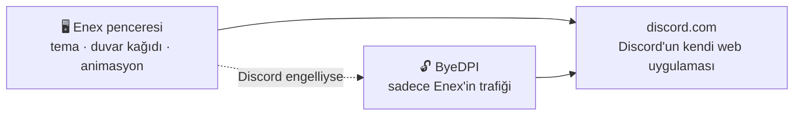

  

  

  
  
  
  

  <b>Türkçe</b> · <a href="README.en.md">English</a>

  <a href="#-neden-enex">Neden Enex?</a> ·
  <a href="#-temalar">Temalar</a> ·
  <a href="#-kurulum">Kurulum</a> ·
  <a href="#️-kısayollar">Kısayollar</a> ·
  <a href="#-sss">SSS</a>

---

**Enex**, Discord'u kendi penceresinde açan ve ona yepyeni bir görünüm kazandıran bir masaüstü
uygulamasıdır. Hareketli duvar kağıtları, saydam cam pencereler, neon temalar ve akıcı
animasyonlar… Üstelik Discord'a erişim engelliyse **tek tıkla, VPN'siz** bağlanır.

  
   <i>Anime teması: saydam Discord, arkada hareketli Sakura Gecesi duvar kağıdı</i>

## ✨ Neden Enex?

<table>
  <tr>
    <td width="50%" valign="top">
      <h3>🎨 8 hazır tema, tek tıkla</h3>
      Tema Stüdyosu'ndan (<kbd>Ctrl</kbd>+<kbd>Shift</kbd>+<kbd>T</kbd>) bir temaya tıkla, anında
      değişsin. Yeniden başlatma yok, ayar dosyası yok.
    </td>
    <td width="50%" valign="top">
      <h3>🌸 Canlı duvar kağıdı</h3>
      Discord'un arkasında hareketli bir sahne. Hazır olanı kullan ya da kendi
      <b>videonu veya resmini</b> seç.
    </td>
  </tr>
  <tr>
    <td valign="top">
      <h3>🪟 Cam pencere</h3>
      Pencere saydamlaşır, masaüstün arkadan görünür. <b>Buzlu cam</b> ya da <b>tam saydam</b>,
      koyuluğunu sen ayarla.
    </td>
    <td valign="top">
      <h3>🔓 Dahili engel aşma</h3>
      Discord engelliyse Enex kendi kendine bağlanmanın yolunu bulur.
      <b>Sadece Enex'in</b> trafiği etkilenir, bilgisayarının geri kalanı olduğu gibi kalır.
    </td>
  </tr>
  <tr>
    <td valign="top">
      <h3>🔒 Hesabın güvende</h3>
      Giriş Discord'un kendi sayfasından yapılır. Enex <b>token'ını görmez, saklamaz, hiçbir yere
      göndermez.</b> Kod açık, kendin kontrol edebilirsin.
    </td>
    <td valign="top">
      <h3>⚡ Hafif ve ayarlanabilir</h3>
      Efektleri, kart düzenini ve sade modu aç/kapa; vurgu rengini değiştir.
      Bilgisayarın zorlanırsa efektleri tek kısayolla kapat.
    </td>
  </tr>
</table>

Ses, görüntü, ekran paylaşımı, bildirimler: hepsi Discord'da nasılsa Enex'te de öyle çalışır.

## 🎨 Temalar

<table>
  <tr>
    <td align="center"> <b>Aurora</b> Mor-pembe kuzey ışıkları</td>
    <td align="center"> <b>Anime</b> Hareketli duvar kağıdı</td>
  </tr>
  <tr>
    <td align="center"> <b>Cam</b> Masaüstün arkadan görünür</td>
    <td align="center"> <b>Neon Tokyo</b> Siberpunk, tarama çizgileri</td>
  </tr>
  <tr>
    <td align="center"> <b>Synthwave</b> 80'ler güneşi, neon ızgara</td>
    <td align="center"> <b>Derin Okyanus</b> Su altı ışıkları</td>
  </tr>
  <tr>
    <td align="center"> <b>Obsidyen</b> Siyah ve altın, en hafif tema</td>
    <td align="center"> <b>Matrix</b> Yeşil terminal</td>
  </tr>
</table>

## 📦 Kurulum

### Kolay yol (önerilen)

1. **[Releases](../../releases/latest)** sayfasından `Enex-Setup.exe` dosyasını indir.
2. Çift tıkla. Enex kurulur ve masaüstüne kısayol eklenir. Hepsi bu.

> [!NOTE]
> Uygulama imzalı olmadığı için Windows "bilgisayarınız korundu" uyarısı gösterebilir.
> **Ek bilgi → Yine de çalıştır** ile devam edebilirsin.

### Kaynaktan derle

1. [Node.js](https://nodejs.org) (LTS) kur.
2. Bu sayfada **Code → Download ZIP** ile indir ve klasöre çıkar.
3. **`Setup.bat`** dosyasına çift tıkla. Gerisini o halleder.

Geliştiriciler için: `npm install` ve ardından `npm start`.

## 🔧 Nasıl çalışır?

Enex, Discord'un resmi web uygulamasını açar ve üstüne sadece **CSS teması** giydirir. Discord
engelliyse arka planda küçük bir yerel proxy ([ByeDPI](https://github.com/hufrea/byedpi))
başlatır ve şifreli DNS kullanır. Birkaç yöntemi sırayla dener, çalışanı hatırlar.

## ⌨️ Kısayollar

| Kısayol | Ne yapar |
|---|---|
| <kbd>Ctrl</kbd>+<kbd>Shift</kbd>+<kbd>T</kbd> | Tema Stüdyosu |
| <kbd>Ctrl</kbd>+<kbd>Alt</kbd>+<kbd>1</kbd>…<kbd>8</kbd> | Temalar arasında geçiş |
| <kbd>Ctrl</kbd>+<kbd>Shift</kbd>+<kbd>E</kbd> | Efektleri aç/kapa (kasarsa kapat) |
| <kbd>Ctrl</kbd>+<kbd>Shift</kbd>+<kbd>L</kbd> | Kart düzenini aç/kapa |
| <kbd>Ctrl</kbd>+<kbd>R</kbd> | Yenile |
| <kbd>Alt</kbd> | Menüyü göster |

## 🖌️ Kendi temanı yap

1. `themes/` klasöründeki bir dosyayı kopyala.
2. İçindeki `--nx-...` renklerini değiştir.
3. `main.js` içindeki `THEMES` listesine ekle.

Güzel bir tema yaptıysan Pull Request gönder, ekleyelim!

## ❓ SSS

<b>Hesabım çalınır mı?</b>

 
Hayır. Giriş Discord'un kendi sayfasında yapılır, Enex şifreni ya da token'ını görmez. Kodun
tamamı burada, isteyen inceleyebilir.

<b>Ban yer miyim?</b>

 
Discord'un kuralları istemciyi değiştirmeyi yasaklıyor. Sadece görünümü değiştiren uygulamalar
yüzünden ban pek görülmüyor ama risk sıfır değil. Aşağıdaki uyarıya bak.

<b>Bilgisayarım kasıyor, ne yapayım?</b>

 
<kbd>Ctrl</kbd>+<kbd>Shift</kbd>+<kbd>E</kbd> ile efektleri kapat ya da <b>Obsidyen</b> temasını seç.

<b>Engel aşma bütün internetimi etkiler mi?</b>

 
Hayır. Sadece Enex'in kendi bağlantısı yönlendirilir. Tarayıcın, oyunların ve diğer uygulamaların
etkilenmez. İstersen Tema Stüdyosu'ndan kapatabilirsin.

<b>Mac veya Linux'ta çalışır mı?</b>

 
Şimdilik sadece Windows destekleniyor.

## ⚠️ Uyarı

Enex, Discord Inc. ile bağlantılı değildir ve Discord tarafından onaylanmamıştır. Discord'un
Hizmet Şartları istemciyi değiştirmeyi yasaklar. Kullanım sorumluluğu sana aittir.

## 📄 Lisans

[MIT](LICENSE) © 2026 Enes · `bin/ciadpi.exe`, [ByeDPI](https://github.com/hufrea/byedpi)
kaynak kodundan derlenmiştir (MIT, bkz. `bin/BYEDPI-LICENSE.txt`).

Enex'i beğendiysen sağ üstten ⭐ vermeyi unutma!

