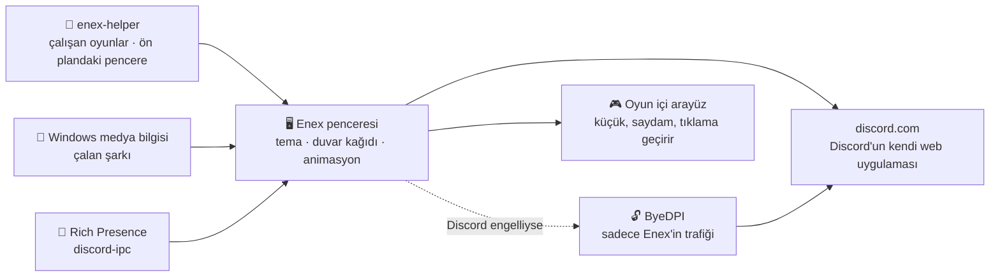

  

  

  
  
  
  

  <b>Türkçe</b> · <a href="README.en.md">English</a>

  <a href="#-yenilikler-v11">Yenilikler</a> ·
  <a href="#-neden-enex">Neden Enex?</a> ·
  <a href="#-oyuncular-için">Oyuncular için</a> ·
  <a href="#-temalar">Temalar</a> ·
  <a href="#-kurulum">Kurulum</a> ·
  <a href="#️-kısayollar">Kısayollar</a> ·
  <a href="#-sss">SSS</a>

---

**Enex**, Discord'u kendi penceresinde açan ve ona yepyeni bir görünüm kazandıran bir masaüstü
uygulamasıdır. Hareketli duvar kağıtları, saydam cam pencereler, neon temalar ve akıcı
animasyonlar… Üstelik Discord'a erişim engelliyse **tek tıkla, VPN'siz** bağlanır.

Ve artık oyuncular için: **oyun içi arayüz**, **"Oynuyor / Dinliyor" durumu** ve oyundayken
FPS'ini korumak için **oyun modu**.

  
   <i>Anime teması: saydam Discord, arkada hareketli Sakura Gecesi duvar kağıdı</i>

## 🆕 Yenilikler (v1.1)

> **Enex 1.1, oyuncu güncellemesi.** Masaüstü Discord'da olup web sürümünde olmayan şeyleri
> Enex'e getirdik, üstüne gizlilik ve performans ekledik. Tüm ayrıntılar
> [CHANGELOG.md](CHANGELOG.md) dosyasında.

- 🎮 **Oyun içi arayüz:** Oyundayken ses kanalındakiler (konuşan parlar) ve gelen mesajlar oyunun ekranında.
- 🕹️ **"Oynuyor" durumu:** Açtığın oyun profilinde görünür. Discord'un tanıdığı ~10.500 oyun otomatik algılanır.
- 🎵 **"Dinliyor" durumu:** Spotify, Apple Music, YouTube Music ya da tarayıcıda çaldığın müzik.
- 🛡️ **Gizlilik filtresi:** Sadece müzik paylaşılır. İzlediğin videolar ve yetişkin içerik asla paylaşılmaz.
- ⚡ **Oyun modu:** Oyundayken Enex'in efektleri durur, önceliği düşer. İşlemci ve ekran kartı oyuna kalır.
- 🔌 **Rich Presence:** Kendi durumunu Discord'a gönderen oyunlar ve uygulamalar Enex'e bağlanır.
- 🪟 **Ayrı pencerede yayın:** "Ayrı pencerede oynat" artık tarayıcıda değil, Enex'in içinde açılır.

## ✨ Neden Enex?

<table>
  <tr>
    <td width="50%" valign="top">
      <h3>🎨 8 hazır tema, tek tıkla</h3>
      Tema Stüdyosu'ndan (<kbd>Ctrl</kbd>+<kbd>Shift</kbd>+<kbd>T</kbd>) bir temaya tıkla, anında
      değişsin. Yeniden başlatma yok, ayar dosyası yok.
    </td>
    <td width="50%" valign="top">
      <h3>🌸 Canlı duvar kağıdı</h3>
      Discord'un arkasında hareketli bir sahne. Hazır olanı kullan ya da kendi
      <b>videonu veya resmini</b> seç.
    </td>
  </tr>
  <tr>
    <td valign="top">
      <h3>🪟 Cam pencere</h3>
      Pencere saydamlaşır, masaüstün arkadan görünür. <b>Buzlu cam</b> ya da <b>tam saydam</b>,
      koyuluğunu sen ayarla.
    </td>
    <td valign="top">
      <h3>🔓 Dahili engel aşma</h3>
      Discord engelliyse Enex kendi kendine bağlanmanın yolunu bulur.
      <b>Sadece Enex'in</b> trafiği etkilenir, bilgisayarının geri kalanı olduğu gibi kalır.
    </td>
  </tr>
  <tr>
    <td valign="top">
      <h3>🔒 Hesabın güvende</h3>
      Giriş Discord'un kendi sayfasından yapılır. Enex <b>token'ını görmez, saklamaz, hiçbir yere
      göndermez.</b> Kod açık, kendin kontrol edebilirsin.
    </td>
    <td valign="top">
      <h3>⚡ Hafif ve ayarlanabilir</h3>
      Efektleri, kart düzenini ve sade modu aç/kapa; vurgu rengini değiştir.
      Bilgisayarın zorlanırsa efektleri tek kısayolla kapat.
    </td>
  </tr>
</table>

Ses, görüntü, ekran paylaşımı, bildirimler: hepsi Discord'da nasılsa Enex'te de öyle çalışır.

## 🎮 Oyuncular için

<table>
  <tr>
    <td width="50%" valign="top">
      <h3>🎮 Oyun içi arayüz</h3>
      Oyundayken ses kanalındakiler köşede görünür, <b>konuşan parlar</b>. Gelen mesajlar
      küçük bildirimler olarak düşer. Tıklamalar oyuna geçer, odağı çalmaz.
        <kbd>Ctrl</kbd>+<kbd>Alt</kbd>+<kbd>O</kbd> ile oyunun içinden aç/kapa.
    </td>
    <td width="50%" valign="top">
      <h3>🕹️ Oynuyor / 🎵 Dinliyor</h3>
      Açtığın oyun ve çaldığın müzik, masaüstü Discord'daki gibi profilinde görünür.
      Rich Presence destekleyen oyunlar (harita, karakter, parça adı…) da Enex'e bağlanır.
    </td>
  </tr>
  <tr>
    <td valign="top">
      <h3>🛡️ Neyi paylaştığın senin elinde</h3>
      Varsayılan <b>Akıllı</b> mod sadece müziği paylaşır: müzik uygulamaları ve tarayıcıda
      çalan müzik videoları. Vlog, film, rastgele videolar paylaşılmaz.
      <b>Yetişkin içerik her zaman engellenir.</b> İstersen kendi yasak kelimelerini ekle.
    </td>
    <td valign="top">
      <h3>⚡ Oyun modu (FPS)</h3>
      Oyun öndeyken Enex'in animasyonları, bulanıklık efektleri ve duvar kağıdı durur,
      işlemci önceliği düşer. Overlay sadece içeriği kadar küçük pencerelerden oluşur.
      Sesli sohbet hiç etkilenmez.
    </td>
  </tr>
</table>

**Paylaşım modları** (Tema Stüdyosu → Etkinlik paylaşımı):

| Mod | Ne paylaşılır |
|---|---|
| Sadece müzik uygulamaları | Spotify, Apple Music, Deezer, TIDAL… Tarayıcıdan hiçbir şey. |
| **Akıllı** (varsayılan) | Müzik uygulamaları + tarayıcıda çalan **müzik** (müzik videoları, YouTube Music, Spotify Web…) |
| Her medya | Tarayıcıda izlediğin her şey. Yasak kelimeler yine de engellenir. |

> [!TIP]
> - Overlay'in görünmesi için oyunu **Kenarlıksız** ya da **Pencereli tam ekran** modunda çalıştır.
>   Normal "Tam ekran" modunda Windows hiçbir pencereyi oyunun üstüne çizdirmez.
> - Profilinde görünmesi için Discord'da *Kullanıcı Ayarları → Etkinlik Gizliliği →
>   "Algılanan etkinlikleri başkalarıyla paylaş"* açık olmalı. Kapalıysa Tema Stüdyosu seni uyarır.

## 🎨 Temalar

<table>
  <tr>
    <td align="center"> <b>Aurora</b> Mor-pembe kuzey ışıkları</td>
    <td align="center"> <b>Anime</b> Hareketli duvar kağıdı</td>
  </tr>
  <tr>
    <td align="center"> <b>Cam</b> Masaüstün arkadan görünür</td>
    <td align="center"> <b>Neon Tokyo</b> Siberpunk, tarama çizgileri</td>
  </tr>
  <tr>
    <td align="center"> <b>Synthwave</b> 80'ler güneşi, neon ızgara</td>
    <td align="center"> <b>Derin Okyanus</b> Su altı ışıkları</td>
  </tr>
  <tr>
    <td align="center"> <b>Obsidyen</b> Siyah ve altın, en hafif tema</td>
    <td align="center"> <b>Matrix</b> Yeşil terminal</td>
  </tr>
</table>

## 📦 Kurulum

### Kolay yol (önerilen)

1. **[Releases](../../releases/latest)** sayfasından `Enex-Setup.exe` dosyasını indir.
2. Çift tıkla. Enex kurulur ve masaüstüne kısayol eklenir. Hepsi bu.

> [!NOTE]
> Uygulama imzalı olmadığı için Windows "bilgisayarınız korundu" uyarısı gösterebilir.
> **Ek bilgi → Yine de çalıştır** ile devam edebilirsin.

### Kaynaktan derle

1. [Node.js](https://nodejs.org) (LTS) kur.
2. Bu sayfada **Code → Download ZIP** ile indir ve klasöre çıkar.
3. **`Setup.bat`** dosyasına çift tıkla. Gerisini o halleder.

Geliştiriciler için: `npm install` ve ardından `npm start`.

## 🔧 Nasıl çalışır?

Enex, Discord'un resmi web uygulamasını açar ve üstüne **CSS teması** giydirir. Discord
engelliyse arka planda küçük bir yerel proxy ([ByeDPI](https://github.com/hufrea/byedpi))
başlatır ve şifreli DNS kullanır. Birkaç yöntemi sırayla dener, çalışanı hatırlar.

**Oyun ve müzik algılama:**
- Küçük bir yardımcı program (`enex-helper.exe`) çalışan programları Discord'un tanınan
  oyunlar listesiyle karşılaştırır. Masaüstü Discord ve arRPC ile aynı yöntem.
- Çalan müzik Windows'un medya bilgisinden okunur.
- Bulunanlar Discord'a, masaüstü uygulamasındaki gibi "yerel etkinlik" olarak verilir.
- Hiçbir oyuna kod enjekte edilmez. Overlay ayrı bir penceredir; hile korumalarıyla
  (Vanguard, EAC, BattlEye) çakışmaz.

Bir şey çalışmazsa Tema Stüdyosu'ndaki **Tanılama günlüğü** (`enex-debug.log`) sorunun yerini gösterir.

## ⌨️ Kısayollar

| Kısayol | Ne yapar |
|---|---|
| <kbd>Ctrl</kbd>+<kbd>Shift</kbd>+<kbd>T</kbd> | Tema Stüdyosu |
| <kbd>Ctrl</kbd>+<kbd>Alt</kbd>+<kbd>1</kbd>…<kbd>8</kbd> | Temalar arasında geçiş |
| <kbd>Ctrl</kbd>+<kbd>Shift</kbd>+<kbd>E</kbd> | Efektleri aç/kapa (kasarsa kapat) |
| <kbd>Ctrl</kbd>+<kbd>Shift</kbd>+<kbd>L</kbd> | Kart düzenini aç/kapa |
| <kbd>Ctrl</kbd>+<kbd>Alt</kbd>+<kbd>O</kbd> | Oyun içi arayüzü aç/kapa (oyundayken de çalışır) |
| <kbd>Ctrl</kbd>+<kbd>R</kbd> | Yenile |
| <kbd>Alt</kbd> | Menüyü göster |

## 🖌️ Kendi temanı yap

1. `themes/` klasöründeki bir dosyayı kopyala.
2. İçindeki `--nx-...` renklerini değiştir.
3. `main.js` içindeki `THEMES` listesine ekle.

Güzel bir tema yaptıysan Pull Request gönder, ekleyelim!

## ❓ SSS

<b>Hesabım çalınır mı?</b>

 
Hayır. Giriş Discord'un kendi sayfasında yapılır, Enex şifreni ya da token'ını görmez. Kodun
tamamı burada, isteyen inceleyebilir.

<b>Ban yer miyim?</b>

 
Discord'un kuralları istemciyi değiştirmeyi yasaklıyor. Sadece görünümü değiştiren uygulamalar
yüzünden ban pek görülmüyor ama risk sıfır değil. Aşağıdaki uyarıya bak.

<b>Bilgisayarım kasıyor, ne yapayım?</b>

 
<kbd>Ctrl</kbd>+<kbd>Shift</kbd>+<kbd>E</kbd> ile efektleri kapat ya da <b>Obsidyen</b> temasını seç.
Oyundayken zaten <b>Oyun modu</b> devreye girer ve Enex'in efektlerini durdurur.

<b>Overlay FPS'imi düşürür mü?</b>

 
Çok az. Overlay oyuna enjekte edilmez; sadece içeriği kadar büyük, saydam, küçük pencerelerdir.
Oyundayken Enex'in animasyonları ve efektleri durur, işlemci önceliği düşer. Yine de her saniye
önemliyse <kbd>Ctrl</kbd>+<kbd>Alt</kbd>+<kbd>O</kbd> ile overlay'i tamamen kapatabilirsin.

<b>İzlediğim videolar profilimde görünür mü?</b>

 
Hayır, varsayılan <b>Akıllı</b> modda sadece müzik paylaşılır. Tarayıcıda çalan bir şey ancak müzik
olduğu belliyse (albüm bilgisi, "Official Music Video", "ft.", "Topic" kanalı gibi) paylaşılır.
Yetişkin içerik her modda engellenir; Tema Stüdyosu'ndan kendi yasak kelimelerini de ekleyebilirsin.
Paylaşılmayan medyanın adı günlüğe bile yazılmaz.

<b>Oyunum algılanmıyor.</b>

 
Enex, Discord'un tanıdığı oyunları otomatik bulur. Listede olmayan bir oyun ekranı tamamen
kaplıyorsa overlay için yine oyun sayılır, ama profilinde "Oynuyor" olarak görünmez.
Tema Stüdyosu'ndaki <b>Durum</b> bölümü oyun algılamanın çalışıp çalışmadığını gösterir.

<b>Hile koruması (Vanguard, EAC) yüzünden ban yer miyim?</b>

 
Enex hiçbir oyuna dokunmaz, kod enjekte etmez; çalışan programların sadece adını okur.
Overlay, oyunun üstünde duran sıradan bir penceredir.

<b>Engel aşma bütün internetimi etkiler mi?</b>

 
Hayır. Sadece Enex'in kendi bağlantısı yönlendirilir. Tarayıcın, oyunların ve diğer uygulamaların
etkilenmez. İstersen Tema Stüdyosu'ndan kapatabilirsin.

<b>Mac veya Linux'ta çalışır mı?</b>

 
Şimdilik sadece Windows destekleniyor.

## ⚠️ Uyarı

Enex, Discord Inc. ile bağlantılı değildir ve Discord tarafından onaylanmamıştır. Discord'un
Hizmet Şartları istemciyi değiştirmeyi yasaklar. Etkinlik paylaşımı ve oyun içi arayüz için Enex,
Discord'un web uygulamasının iç yapısıyla konuşur (Vencord ve Vesktop gibi). Kullanım sorumluluğu
sana aittir.

## 📄 Lisans

[MIT](LICENSE) © 2026 Enes · `bin/ciadpi.exe`, [ByeDPI](https://github.com/hufrea/byedpi)
kaynak kodundan derlenmiştir (MIT, bkz. `bin/BYEDPI-LICENSE.txt`). `bin/enex-helper.exe` ve
`bin/enex-audio.exe` bu depodaki `native/` kaynaklarından derlenir (bkz. `bin/KAYNAK.txt`).
Rich Presence protokolü [arRPC](https://github.com/OpenAsar/arrpc) (MIT) incelenerek yazılmıştır.

Enex'i beğendiysen sağ üstten ⭐ vermeyi unutma!

