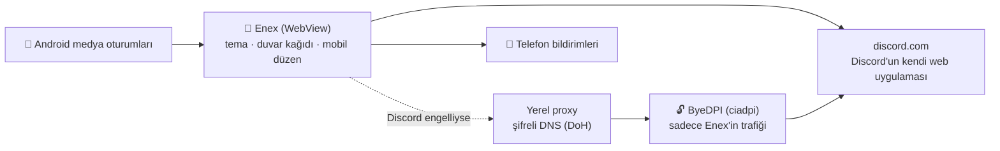

# Enex · Android

Enex'in Android sürümü. Masaüstündeki gibi Discord'un kendi web uygulamasını açar ve üstüne
Enex temalarını giydirir; temalar, önizlemeler ve duvar kağıtları masaüstü projesiyle **ortaktır**
(`../themes`, `../previews`, `../wallpapers` derleme sırasında APK'ya kopyalanır).

## Neler var?

| Özellik | Masaüstü | Android |
|---|---|---|
| 8 tema, efektler, kart düzeni, sade mod, vurgu rengi | ✅ | ✅ |
| Anime teması: video/resim duvar kağıdı + kiraz yaprakları | ✅ | ✅ (kendi videonu/resmini seçebilirsin) |
| Cam teması | Masaüstün görünür | **Telefonunun duvar kağıdı görünür** (Android 12+ bulanık seçeneği) |
| Engel aşma (ByeDPI + şifreli DNS, sadece Enex için) | ✅ | ✅ VPN gerekmez, yöntemi kendisi bulur ve hatırlar |
| Ses %300'e kadar (renkli bölgeler + uyarılar) | ✅ | ✅ |
| "Dinliyor" durumu + gizlilik filtresi (Akıllı / Sadece müzik / Her medya) | ✅ | ✅ Telefonda çalan müzik ("Bildirim erişimi" izniyle) |
| Mesaj bildirimleri | Discord'un kendisi | ✅ Telefon bildirimi olarak, dokununca ilgili kanala gider |
| Arka planda bağlı kalma (ekran kapalıyken sesli sohbet) | — | ✅ |
| Mobil düzen: sunucular/kanallar çekmecede | — | ✅ Geri tuşu ya da sağa kaydırma ile açılır; arayüz boyutu ayarlanır |
| `discord.gg` davet bağlantılarını Enex'te açma | — | ✅ |
| Oyun içi arayüz, "Oynuyor" durumu, Rich Presence, ekran paylaşımı | ✅ | ❌ (telefonda karşılığı yok) |

**Kullanım:** Ekrandaki yuvarlak Enex düğmesine dokun → *Tema Stüdyosu*, *Sunucular ve kanallar*, *Yenile*.
Düğmeyi sürükleyerek kenara taşıyabilirsin. Geri tuşu: açık pencereyi kapatır → çekmeceyi açar →
Enex'i arka plana alır (bağlı kalır). Tamamen kapatmak için bildirimdeki **Kapat**.

## APK'yı nereden alırım?

Bu depo GitHub'a gönderildiğinde **Actions → Android APK** iş akışı APK'yı resmi Android araçlarıyla
derler. Son çalışmanın **Artifacts** bölümünden `Enex-Android` dosyasını indir (içinde `Enex-Android.apk`).
`v1.2.0-android` gibi bir etiket gönderirsen APK otomatik olarak bir **Release** olarak da yayınlanır.

Telefonda "bilinmeyen kaynaklardan yükleme" iznini vermen gerekir (APK Play Store'dan gelmiyor).

### Sabit imza anahtarı (önerilir)

Anahtar tanımlanmazsa APK hata ayıklama anahtarıyla imzalanır; her derlemede anahtar değişebileceği
için güncellemeden önce eskisini kaldırman gerekebilir (giriş kaybolur). Bir kez anahtar oluştur:

```bash
keytool -genkeypair -v -keystore enex.jks -alias enex -keyalg RSA -keysize 4096 -validity 10000
base64 -w0 enex.jks   # Windows PowerShell: [Convert]::ToBase64String([IO.File]::ReadAllBytes("enex.jks"))
```

GitHub'da *Settings → Secrets and variables → Actions* altına ekle:
`ENEX_KEYSTORE_B64` (base64 çıktısı), `ENEX_KEYSTORE_PASSWORD`, `ENEX_KEY_ALIAS` (`enex`), `ENEX_KEY_PASSWORD`.
`enex.jks` dosyasını **depoya koyma**, güvenli bir yerde sakla.

## Kendi bilgisayarında derle

1. [Android Studio](https://developer.android.com/studio)'yu kur.
2. *SDK Manager → SDK Tools* altından **NDK (Side by side) 27.2.12479018**'u kur (ByeDPI bununla derlenir).
3. Android Studio'da **bu `android` klasörünü** aç (üst klasördeki masaüstü dosyaları da yerinde olmalı).
4. Telefonu USB hata ayıklamayla bağla ve ▶ **Run**. APK için: *Build → Build APK(s)*.

Komut satırından: `./gradlew assembleRelease` (Windows'ta `gradlew.bat assembleRelease`).

## Nasıl çalışır?



- **Temalar:** Masaüstüyle aynı CSS dosyaları, Discord'un güvenlik politikasına takılmayan
  "constructable stylesheet" ile eklenir. `app/src/main/assets/page/mobile.css` telefona özel katmandır.
- **Mobil düzen:** Discord'un web arayüzü geniş ekran için. `page/inject.js`, sunucu listesini, kanal
  listesini ve sohbeti sınıf adlarından bağımsız olarak içerikten bulur ve tek sütunlu çekmeceye çevirir.
- **Engel aşma:** WebView sadece `127.0.0.1`'deki küçük bir proxy'ye bağlanır (androidx.webkit
  `ProxyController`). Bu proxy alan adlarını şifreli DNS ile çözer ve bağlantıyı ByeDPI'ye (SOCKS5)
  verir. Yöntemler masaüstüyle aynıdır, sırayla denenir, çalışan hatırlanır. Telefonun geri kalanı etkilenmez.
- **ByeDPI:** `third_party/byedpi` (MIT, masaüstündeki `ciadpi.exe` ile aynı commit:
  `ba532298`) her mimari için NDK'nın clang'ıyla derlenir ve APK'ya `libciadpi.so` adıyla konur
  (Android sadece bu klasördeki programların çalıştırılmasına izin verir).
- **%300 ses:** Masaüstüyle aynı yöntem; Discord ana sayfasının CSP'sine sadece `'unsafe-eval'` eklenir.
- **Hesabın güvende:** Giriş Discord'un kendi sayfasında yapılır; Enex token'ı görmez, saklamaz, göndermez.
  Bildirim erişimi izni sadece çalan müziği okumak içindir; bildirimlerin içeriği okunmaz.

Bir şey çalışmazsa Tema Stüdyosu → **Tanılama günlüğünü paylaş** (`enex-debug.log`).

## Bilinen sınırlar

- Discord'un web arayüzü telefon için tasarlanmadı; bazı açılır pencereler dar ekranda sıkışık
  görünebilir. Stüdyo'dan **Masaüstü** düzenine geçip iki parmakla yakınlaştırabilirsin.
- Discord arayüzünü değiştirirse mobil düzenin bazı parçaları bir süre düzgün çalışmayabilir.
- Ekran paylaşımı Android WebView'da desteklenmiyor.
- Giriş ekranındaki QR kodu gizlenir (telefonda kendi ekranını okutamazsın); e-posta/şifre ile giriş yap.

## ⚠️ Uyarı

Enex, Discord Inc. ile bağlantılı değildir ve Discord tarafından onaylanmamıştır. Discord'un Hizmet
Şartları istemciyi değiştirmeyi yasaklar. Kullanım sorumluluğu sana aittir.
